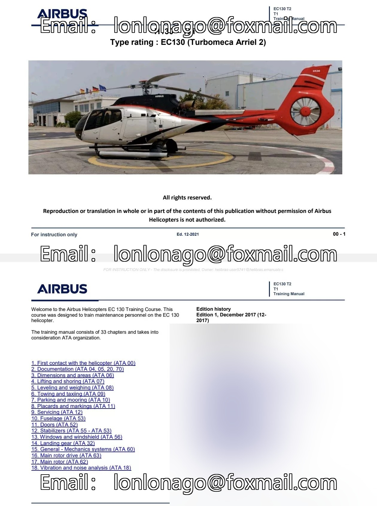
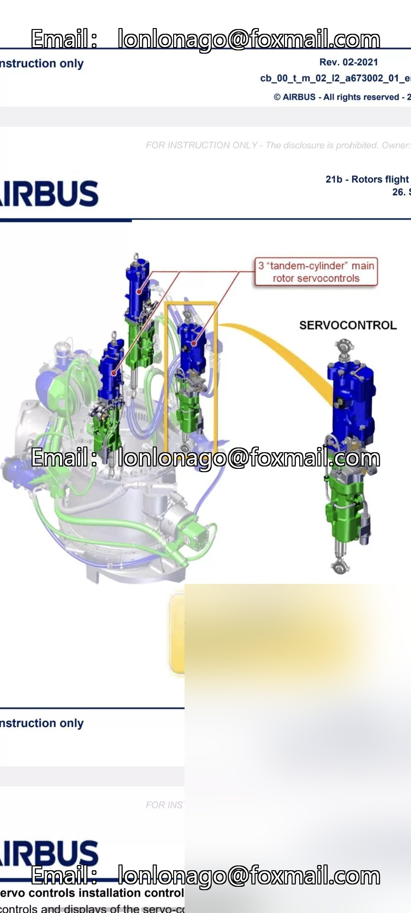
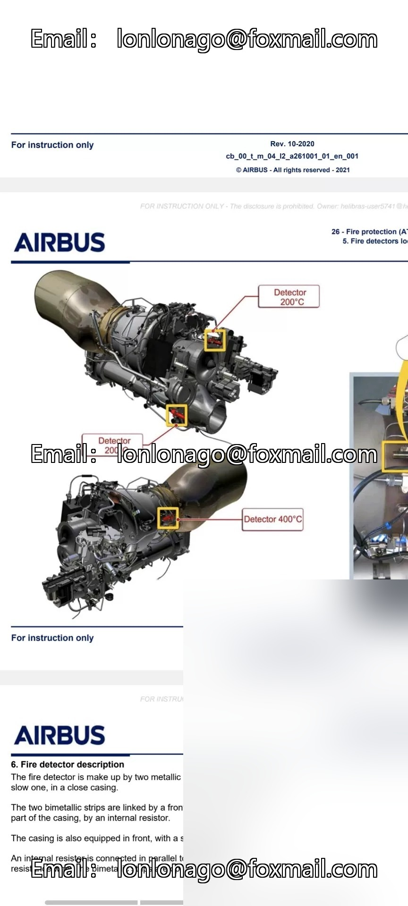
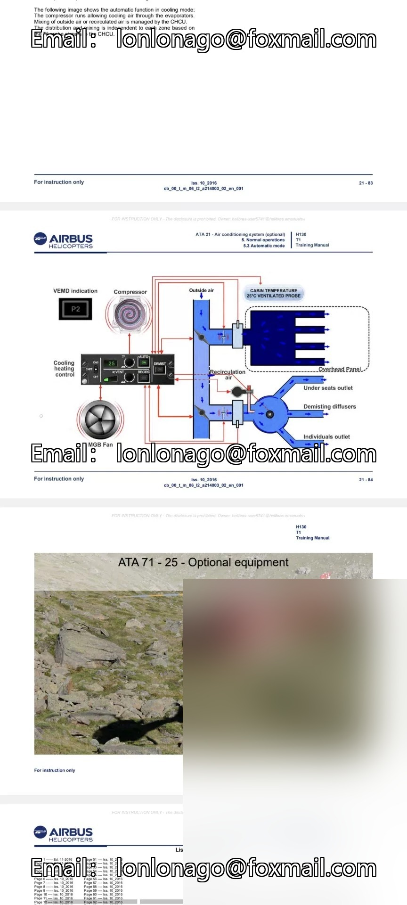

# Airbus Helicopters (Airbus Helicopters) issued

## Body

Airbus Helicopters published the "EC130 T2 / T1 Training Manual" which is approximately 2400 pages.
Its corresponding specific aircraft model is H130 - TXi (utilizing Thales TXi avionics system), and the obtained type rating is EC130 (equipped with Fairmile Arriel 2 engines).

The manual is version 4. Published in December 2021. Version history shows that it has been revised multiple times since its first edition in early 2017. States that technical content continues to be updated. The current version reflects the latest standard construction and system configuration of this model.

Aerospace Helicopter H130 Training Manual TM / EC130 Model Training ARRIEL 2D Engine
EC130 helicopter training manual, detailing principles, functions, components, usage, etc. in detail chapter by chapter, covering 2492 pages.
Single-engine lightweight general-purpose helicopter developed by European Helicopter Company
The EC130 helicopter is a single-engine turboaxial lightweight general-purpose helicopter developed by European Helicopter Company (now Airbus Helicopters), derived from the AS350 B3 model, completing its first flight on June 24, 1999.
The variant adopts a propeller-driven tail design, with the cockpit width increased by 20% compared to the base model, equipped with a modular cabin layout and noise reduction technology, meeting the most strict noise restriction standards of the International Civil Aviation Organization [3].

As of 2015, the cumulative delivery volume reached 140 aircraft [1], suitable for diverse scenarios such as sightseeing transportation, medical rescue, and aerial law enforcement.
Its improved EC130 T2 passed FAA supplemental type certification on January 27, 2015, upgraded the avionics system, and extended the maintenance cycle to 6,000 hours.

The material covers training manuals published by Airbus Helicopters, including EC130 T2, H130 - TXi, Type rating EC130 with Turbomeca Arriel 2 engine, and H130 details.

<!-- AI_ENRICHED -->

## Images

## Payment

Here is a pay link on Stripe ( https://buy.stripe.com/3cs8yP7sY87d0vu9AB ). Please contact me lonlonago@foxmail.com after funding $89, and I will send you a complete data files , thank you!

